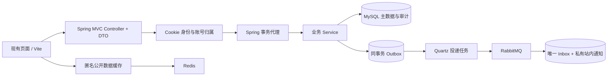

# 用工贸港准备 Java 社招：代码阅读与实操路线

这份材料对应你提供的《Java后端学习规划.xlsx》：Java SE、MySQL/JDBC、Spring/MyBatis、Redis/RabbitMQ/Quartz、并发/JVM及部署。目标是能解释和独立重现关键流程，再将相应工作写进简历。网站有业务完整度，但演示数据不代表真实交易量或客户案例。

## 先运行，再建立整体认识

先按 [JAVA-START.md](JAVA-START.md) 跑通本地版本，使用业务账号提交、另一位管理员核验。先体验一笔授信到回款的流程，不从最长的风控 Service 第一行开始背。



Redis 与 MQ 都不在资金正确性的必要路径上。财务操作提交时已经完成余额、业务流水、审计；消息通知失败不表示扣款或核销失败。

## 第一轮：按 10 个入口读代码

| 顺序 | 入口 | 读完应能回答 |
| --- | --- | --- |
| 1 | `common/Money.java` | 为什么钱不用 double；币种能否相加；空值与零有什么不同 |
| 2 | `api/Requests.java` | 请求 DTO、Bean Validation 与业务校验的职责如何区分 |
| 3 | `auth/ApiAuthFilter.java` | Cookie 怎么找到用户；为什么只在前端隐藏按钮不够 |
| 4 | `persistence/Transactions.java` | 事务从哪里开始；异常怎么回滚；为什么单独建代理 Bean |
| 5 | `persistence/DocumentMapper.java` | 参数绑定怎么防注入；表名为什么必须白名单 |
| 6 | `risk/RiskService.java` 的 request/decide | 授信与占额为何分开；同业务键不同内容为什么拒绝 |
| 7 | `risk/RiskFlowService.java` 的 allocation/reverse | 回款、核销、额度释放的区别；冲销为什么恢复债务 |
| 8 | 同文件的 gate/consumeShipment | 为什么审批后仍需再校验；过期、重复、版本变化怎样处理 |
| 9 | `integration/OutboxService.java` / `MessagingConfig.java` | DB 与 MQ 不是一个事务时怎么保证最终投递；重复消息怎么办 |
| 10 | `integration/QuartzConfig.java` / `CatalogCache.java` | 定时任务、缓存如何帮助业务；它们失效时哪些保证仍成立 |

其中原 JSON 文档表是迁移边界，动态 `Doc` 不意味着你应该在所有 Java 项目里都用 Map 代替实体。命令 DTO、Money 值对象、OutboxEvent 展示了不同职责的类型。面试时要能解释为什么保留旧存储，以及如何分阶段迁往关系表。

## 实验 1：把用户与数据权限讲清楚

1. 用两个业务账号登录，分别创建档案；第二个账号不能看到或修改第一个的资料。
2. 在浏览器开发者工具中把请求的 profileId 换成另一账号的编号，观察 404。
3. 业务账号调用管理员审批，观察 403；管理员不能审批自己的申请。
4. 修改一份客户资料，再尝试使用旧版本授信，观察版本检查。

讲解要点：认证解决“是谁”，授权解决“能做什么”，数据权限解决“能处理谁的记录”。管理员有明确跨账号复核权限，普通业务账号没有。

## 实验 2：幂等与事务不是一回事

找同一笔占额或核销申请：

- 同业务唯一键、同内容：返回原有记录。
- 同业务唯一键、不同内容：409，不覆盖原操作。
- 同一审批、同决定与理由重复提交：不重复记账。
- 同一审批改决定或理由：拒绝覆盖历史。

事务控制一组操作的原子性；幂等控制重复请求的业务效果；行锁控制并发竞争。三者不能互相替代。HTTP 超时也不代表数据库必然回滚，客户端应查询原业务键状态。

## 实验 3：并发抢额度

客户额度 1,000 USD，同时申请两笔各 600 USD 的占用。期望只有一笔批准，最终占用 600 USD。

执行 `tests/java/backend-contract.test.mjs` 中的并发测试，再阅读 `Transactions.write` 与 `RiskService.decide`。重点观察：

- 事务中先锁 `ip_risk_locks.operations`，再读取和修改余额。
- 库存、占额、审计的锁顺序保持一致。
- 该锁跨进程生效；Java `synchronized` 只能限制一个 JVM。
- 当前全局锁是为兼容旧审计根和小规模系统采取的保守方案，限制吞吐。它不是高并发设计的终点。

进阶练习：在独立练习分支设计关系表和账号级锁，比较全局锁与账户行锁；同时讨论审计链分段、死锁顺序与对账。不要直接在线上换锁实验。

## 实验 4：部分失败整批回滚

一笔到账分配给两张应收：第一张金额合法，第二张超过剩余余额。预期：第一张应收、合同已收、资金已分配、额度及流水全部不变。

先把事务注解暂时移除，在本地观察失败结果，再恢复注解。说明 `rollbackFor`、运行时异常、捕获异常后不继续抛出的影响，以及 `this.xxx()` 自调用不经过 Spring 代理的问题。

## 实验 5：冲销与直接改余额的区别

先占用 600 USD，核销 400，再把总额度调整为 300，最后冲销该次核销。

正确结果：真实债务恢复到 600，额度占用恢复到 600，并冻结新增业务。不能因为新额度只有 300，就拒绝恢复债务或把差额隐藏。原核销、反向批次和理由都应能追溯。

可以解释“真实余额必须反映事实”和“是否允许新增交易”是两个问题。

## 实验 6：审批快照与状态机

订单推进到待装运，取得一次性发货批准，然后：

1. 核销一笔收款，或修改规则/实货信息。
2. 使用原批准尝试发货，应要求重新复核。
3. 新批准执行成功后，重复相同请求只返回既有运输状态，不顺便推进到已完成。

讲清正常状态迁移、前置条件、例外审批、硬条件不可绕过，以及整单发货与分批发货的模型差异。

## 实验 7：中间件不是“加上就可靠”

用本地 `infra` profile：

- Redis 关闭后匿名页面回源，财务计算不读取缓存。
- 查看 `ip_outbox`：业务提交后事件先落表，再发送；重启前后事件仍在。
- 重复投递同一个事件，`ip_notification_inbox` 的主键使通知只写一次。
- 无效消息或重复失败消息进入死信队列，不能无限立即重试。
- 观察 RabbitMQ Confirm 与 Return：进入交换机、路由到队列、被消费者处理是不同阶段。

当前提供至少一次投递与幂等消费，不宣称跨数据库和 MQ 的“绝对 exactly-once”。Outbox 的事件编号由业务事件计算，重试审批不会再插一条相同通知事件。

## 实验 8：读执行计划与连接池

在独立本地库运行：

```sql
EXPLAIN SELECT id FROM ip_outbox
WHERE status IN ('NEW', 'RETRY', 'SENDING') AND available_at <= 2000000000000
ORDER BY available_at, id LIMIT 1;

EXPLAIN SELECT id, topic, entity_id, created_at FROM ip_notifications
WHERE owner_id = '你的本地测试账号'
ORDER BY created_at DESC LIMIT 100;
```

理解联合索引、过滤、排序、回表与数据量的关系。小表可能走全表扫描；不要把“EXPLAIN 中出现 ALL”机械地等同于错误。旧风险文档目前存在全表读取和应用层过滤，这是一项明确的性能局限，不应包装成成熟大规模系统。

Hikari 上限、Tomcat 线程上限、数据库并发和等待队列需要一起考虑。把线程数无限调大可能增加连接等待和内存占用，不能据此保证吞吐提升。

## 实验 9：密码与 JVM 内存

用兼容测试观察 Node 与 Java 对 scrypt 参数和盐字节解释的一致性。密码验证的内存消耗较高，`PasswordService` 用信号量限制同时计算数量，防止少量并发登录占满小实例堆内存。

观察启动脚本中的 Xmx、Metaspace、Code Cache、线程栈与 GC 参数。Xmx 不是进程全部内存；选 Serial GC 是小实例部署取舍，不是所有 Java 服务都应采用的配置。

## 实验 10：补充你自己的设计

完成前九项后，在练习分支自行实现并测试：

1. 让客户、额度、应收从兼容 JSON 表迁入关系表：设计唯一约束、外键、索引和迁移校验，不先删除旧数据。
2. 增加一项有真实业务意义的授信条件，分别写正常、拒绝、并发及越权测试。
3. 给死信处理增加管理员受控的查询与重投，保留重投理由；当前还没有完整的运维重放后台。
4. 如果改用 JWT，说明如何退出、失效、刷新和撤销，不能只把 session 换成一个长期令牌。

这些练习应由你亲自实现，保留提交、故障现象、定位过程和测试结果，比背一份“标准项目介绍”更有用。

## 六个月使用安排

| 时间 | 重点 | 可验收产出 |
| --- | --- | --- |
| 第1个月 | 本地运行、API、数据库、登录权限 | 自己画流程，完成实验1–2，能修改DTO并联调 |
| 第2个月 | 授信、占额、事务、并发 | 完成实验3–4，手写最小账户行锁 Demo |
| 第3个月 | 应收、核销、冲销、发货状态机 | 完成实验5–6，独立解释一条完整交易链 |
| 第4个月 | Redis、MQ、Quartz 与故障 | 完成实验7，能停服务、看状态并恢复 |
| 第5个月 | SQL/JVM、一次自主功能迭代 | 完成实验8–10中的一项，记录实际测量 |
| 第6个月 | Java基础补缺、算法、模拟面试 | 2分钟介绍、10分钟深挖、现场修改核心代码 |

## 面试介绍框架

可以按“业务问题 → 一致性约束 → 实现选择 → 验证证据 → 当前限制”讲述。示例：

> 工贸港是一个工业品采购及钢贸风控项目。我学习并完善了 Java 后端，重点研究授信占用与回款核销的一致性。对重复请求采用业务唯一键，对并发操作使用 MySQL 事务与行锁；一笔到账可分配到多笔应收，失败时整批回滚。异步通知使用 Outbox 和幂等消费，财务审计仍与账务同步提交。迁移时兼容原有账号及审计数据，保留了回归和跨语言验证。

这段应根据你真正能独立完成和解释的部分修改。演示账号、测试订单和本地双实例不是生产客户、真实流水或线上集群；并发量、响应时间等数字应来自你自己的测量。

## 学习表中需要纠正的几处表述

- JDK 17 常见服务器环境默认 GC 是 G1，不能笼统说默认 ZGC；CMS 在 JDK 17 已被移除。
- LinkedList 插入删除的优势要区分是否已经定位节点；按下标定位仍需要遍历。
- JWT 本身不能解决注销和撤销问题；用了 JWT 也不代表系统完全无状态。
- MQ 可靠性通常通过重试、幂等和对账实现，不能只开“持久化”就保证永不丢失或重复。
- 学习表总览提及 Spring Cloud Alibaba，但详细阶段主要是单体与部署，本项目暂不据此增加微服务组件。
