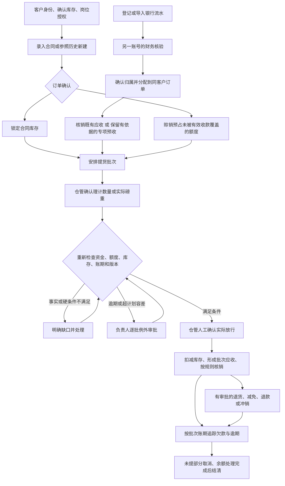

# 钢贸业务与风控：设计、操作及验收

## 本轮定位

现有 InduPort 内新增的企业工作台，地址 `/#steel`。沿用 Java 17 / Spring Boot、React、MySQL、原账号 Cookie 和审计链；不创建新项目、服务或付费中间件。原采购目录、跨境订单、风险档案和历史仍保留，`/#risk` 增加新工作台入口。

首轮范围由需求访谈确定：一家企业内部、自有钢材现货、人民币、一个本方主体、理计/磅计、分批提货，支持先款后货及经批准的赊销。每个企业工作空间固定一种数据性质：测试或真实；创建人可各建一个，不能把测试企业改成真实企业。已有演示账号显示独立的三组只读业务案例；原九组风险案例仍在。

这是可独立验收的内部试运行版本。尚无真实业务人员或交易数据参与验证，不能声称已证明真实经营收益、降低坏账比例或适配所有钢贸模式。

## 业务主线



审批通过不是实际出库；导入流水不是到账核实；到账不是已经核销；减免应收也不是银行已经退款。系统分别记录这些事实。

## 金额、重量与费用

- 业务币种固定 CNY，API 不接受调用方改为 USD 或指定单位。原外贸模块继续独立保留 USD/CNY 逻辑，不自动混入本工作台。
- 金额用整数分，重量以整数克存储、以吨输入和展示，吨数最多六位小数。运算使用 BigDecimal，金额四舍五入到分。
- 商品价款由合同计价重量与吨单价计算。未税单价另加约定税率；含税单价不重复加税。本模块不替代税务申报、发票或法定总账。
- 客户承担且未含入商品价的费用才额外计入应收；本方承担的费用不增加客户欠款。实际费用成本另存，用于测算，不混入应收。
- 理计按合同及计重凭据中的理论重量计价；实际磅重作为另一项事实保存，不填时保持空值。本轮不提供基于不完整规格自行推算理论吨位的通用公式。磅计页面只录一次实磅重量，系统同步计价重量，接口仍检查两者一致。
- 每批按合同金额比例分摊价款与费用，最后一批承接舍入尾差，避免分批合计多收或少收一分钱。
- 先款后货要求本批全部价款覆盖。赊销仍须满足合同约定的先付费用；费用后付必须在获批赊销条件内处理。
- 本轮没有把保证金充当货款的入口。需要保证金抵扣、担保或票据业务时应另建经审核的权益模型；原风控档案中的保障资料不会自动增加新工作台可用资金。

未知成本保留 null、显示“资料待补齐”。不凭空填成本，不按零判断低风险。商品价差只在成本和售价税口径一致时计算；它不等于完整利润，未扣除费用、税负差及经营开支。钢价压力默认5%，运费压力默认10%；运费成本不明时不报告数值。固定 CNY 的试点没有汇率敞口，原风控模块继续保留3%的汇率压力场景。

## 库存：承诺、实物、退货分开

1. 仓管凭库存、货权和质量依据登记可售库存；成本可以未知。
2. 业务员确认订单时锁定对应仓库、规格材质、计重口径及批次库存；草稿不锁量。
3. 每批计划数量不得超过本单尚未安排的可提量；计重修改不得挤占其他批次。
4. 仓管实际放行时重新检查并扣减实物库存，同时减少相应锁量。
5. 取消未提部分释放锁量；实际出库记录不能用“取消订单”抹掉。
6. 退货先入待检，负责人独立验收通过后才恢复可售并记减应收。验收未通过的货物继续隔离，不能再次当成可售库存。处置或返还不合格品需后续补充专门流程。
7. 盘点差异经过申请、独立批准、仓管入账。真实短缺可以如实入账；已承诺量大于实物时显示缺口、产生待办，并阻止不满足条件的放行，不虚增库存来凑平。

默认重量容差为0。负责人可按合同设置可追溯容差；容差只能处理“计划与本批实际”的变化，不能越过合同剩余数量、实际库存或付款条件。

## 收款：自动带出和推荐，关键事实独立确认

- 负责人先登记稳定的本方收款账户编号及归属核验依据，例如 BANK001，后续登记和导入统一使用编号。
- 业务或财务登记/导入流水，按本企业、账户编号和银行流水号唯一识别。同一流水内容一致则去重，内容冲突则拒绝覆盖。
- 手工和文件导入都不能绕过独立核验：登记账号不能确认自己的到账；核验者必须有本企业财务权限，并留下原始银行记录依据。
- 财务可一次提交“到账确认+订单分配”，后台在同一事务中完成两种记录；任一步错误整笔回滚。
- 已确认的款项只能分配到同一企业、同一客户的订单；剩余款项保持未分配，不自动抵其他客户欠款。
- 默认优先核销本单已有应收，按到期日顺序处理。若客户明确约定为专项预收，财务必须选择对应用途并记录依据；旧欠款及逾期仍保留。
- 多个待提批次按建立顺序预留本单可用预收。退款批准后也预留资金；同一笔钱不能同时覆盖两个批次、两笔退款或出库与退款。
- 未分配款项可以单独申请原路退款，不强迫制造一张订单。

银行流水导入格式（每批1–200行，内容最多80KB）：

```csv
customerNumber,bankAccount,bankReference,payer,amount,receivedOn,evidence
```

使用已存在的本企业客户编号和收款账户编号；金额为人民币元。JSON 为同字段对象数组。未知金额、归属或日期需先核实，任一行错误整批回滚。确认日期不得晚于企业当前业务日。

## 授信：一笔敞口只计一次

基础授信由业务/财务申请、另一名负责人批准，明确总额、有效期、最长账期、可选单笔上限、条件及依据。默认没有额度。

赊销占用的概念口径为：

> 已生效合同仍需履行的金额＋已形成应收的净额－本单有效资金覆盖。

实现中以合同总额减去取消、退货/减免和有效资金分配计算，防止发货前承诺与发货后应收重复相加。草稿不占额，发货不再额外叠加同一笔占用；取消未履行部分、收款分配、退货或冲销都会重新计算。

临时授信是独立批准、限订单、限金额、限期限的额度，不是修改客户总额的文字备注。其他订单不能借用；合同核心条款变化后原临时额度失效。金额0的批准用于撤销。基础授信有效期、账期及单笔条件仍须满足，临时额度不替代首次客户授信。

降低额度或冲销后可能出现“占用高于额度”，系统保留真实债务并阻止新增风险，不截断或隐藏占用。

## 放行、审批与预警

| 类型 | 处理 |
| --- | --- |
| 未核验到账、重复占款、库存/合同量不足、金额或归属不明确 | 先纠正，不能凭审批理由绕过 |
| 基础授信未批、过期、额度或账期不满足 | 先获得相应授信或合同条件调整，再校验 |
| 客户逾期、实际重量超过计划容差 | 可提交准确绑定本批当前状态的例外申请，记录理由、措施及责任人 |
| 正常业务满足条件 | 对应岗位确认，无额外逐单找负责人审批；实际放行仍由获授权仓管人工操作 |

例外批准24小时有效且只执行一次。订单、库存、收款、授信、公司规则或关键风险输入变化后失效。放行时在事务内重新计算，不信任浏览器之前看到的“可放行”。

按每批实际出库日加合同账期生成到期日；合同明确固定日期时按该日期执行。部分收款只消除对应金额，新批次不延长旧欠款账期。按上海自然日计算：逾期1天预警，7天升级。负责人可修改初始阈值，保留版本和理由；这些参数没有历史校准依据。

Quartz 在服务进程运行时每15分钟扫描企业业务，打开工作台时也立即复查，自动追加或更新预警记录并保留输入及规则快照。当前不发送短信、邮件或外部催收消息。

现有免费 Render 会休眠，休眠期间内存调度不会运行，因此当前部署不能承诺全天持续预警；唤醒并打开工作台后补查。真实业务正式使用前需采用常驻运行环境或可靠的独立调度，并验证恢复与告警机制，新增费用需另行确认。

待办自动关联订单、批次、金额和处理岗位，可指定具有相应岗位的本企业负责人，记录待处理/处理中/等待补充及说明。业务状态变化或规则经授权调整后，提醒标记为“当前规则下不再触发”，处理历史保留；不能手工点“完成”隐藏尚存风险。

## 改单、退货、退款与冲销

- 未执行订单通过独立审批变更条款，重新计算库存与授信；须先撤回未执行批次。
- 已实际出库部分不直接覆盖。未提部分可取消；新增数量或新条款另建可追溯合同，旧批次和债务保留。
- 退货申请、批准、仓管实收、独立验收分别记录；退货商品按原批次价款比例记减，费用不自动退，需另提明确减免。
- 已核销金额大于退货后净应收时，多出的部分回到本单预收；是否实际退款仍另行审批、执行。
- 退款只能使用未被消费/预留的余额，批准与执行分离，财务确认真实原路付款凭据。系统不调用银行自动付款。
- 核销分配冲销经独立批准后恢复应收、回退对应资金占用，保留原记录。已有批准待退资金或已执行退款时不能直接冲销资金来源。
- 未核验流水可以申请更正客户、金额、付款人或日期；原账户与流水号不覆盖，保留更正前后及批准记录。已核验后的错误先处理资金去向：全部分配已冲销、没有已付或预留退款时，可以独立批准撤销误核验，保留原确认历史，回到待核验后再更正；不得用此动作抹掉实际退款。
- 未执行申请可以按权限撤回；已经入账的授信或调整不能通过撤回按钮倒抹历史。
- 数量履行/取消、应收及预收、待办审批均处理完后才能结清。结清后售后需独立批准重新开启。

## 岗位与隔离

| 岗位 | 主要动作 |
| --- | --- |
| 业务 | 客户、订单、合同变更申请、提货计划、收款资料登记/导入、业务例外申请 |
| 财务 | 独立核验到账、分配资金、核销冲销申请、退款申请与实际付款登记 |
| 仓管 | 库存确认、批次计重、人工放行、退货实收、盘点与批准后的盘点入账 |
| 负责人 | 独立审批、验收确认、企业规则调整、待办指派 |

创建人默认业务+负责人，只能由创建人授予/停用员工岗位。员工沿用原注册账号，可兼岗；关键申请与审批、到账登记与确认、退款批准与执行、退货实收与验收仍须不同账号。平台管理员没有自动绕过企业成员授权的操作权。

授权范围是本企业协作数据；本轮不做部门、业务员客户池或敏感字段级权限。跨企业访问、导入引用、审批及执行都在服务端校验；请求不能指定 ownerId、actorId、状态、记账分值或其他币种。演示账号只读。

## 你可以独立完成的验收

建议在本地或线上专门的**测试企业**中操作，分别登录独立测试账号。测试记录不能进入真实企业。

1. 用供应商账号创建测试企业，作为负责人/业务账号；再注册财务与仓管账号，由创建人授权。需要测试独立核验时让业务账号登记、财务账号确认。
2. 负责人登记本方收款账户 BANK001；业务建立客户；仓管登记10吨明确计重口径的库存。
3. 业务建立2吨、4000元/吨的先款后货合同，明确税口径，确无费用时填0。确认后检查库存锁定2吨。
4. 业务登记4000元到账；财务查看原始测试凭据后确认并分配。安排1吨提货，仓管计重并人工放行；应收清、库存减少1吨，另一吨仍锁定。
5. 再安排第二批，不补款应提示差额；原资金不能再次使用。
6. 按审批流程测试赊销：订单生效预占、分批出库不重复占额、核销后释放、冲销后恢复债务。
7. 对第一批退回0.25吨，检查先入待检，再经独立验收恢复可售；1000元回到预收，批准并确认退款后余额归零。
8. 测试重试、两个批次争用资金、超库存、规则改变后使用旧例外、手工修改请求里的企业/客户/金额单位等异常。
9. 记录你在哪一步看不懂、重复输入、找不到下一步；参照历史新建功能只带出条款参考，不复制原审批或已收金额。

内置三组演示用于看流程；真正操作请使用独立测试企业。所有例子是验收用测试单据，不代表真实贸易案例。

## 技术保证和当前边界

- 新表 `ip_steel_records` 与旧业务隔离，包含企业、成员、合同、库存、到账、分配、支付关联、审批、任务状态、幂等记录及追加流水。企业、类型、客户、订单为生成列并建索引；业务查询绑定参数，企业按二进制精确匹配。
- 保留 JSON 文档兼容存储和原审计根；所有变更经现有 `Transactions.write` 数据库锁，在同一事务中完成余额/库存、业务唯一键及审计。`SteelService` 中不自行开第二套内存锁。
- MySQL 连接及套接字读操作分别设10秒和20秒上限，连接池校验/保活与轮换有明确时间；失败不回退到本地数据库，也不因此自动放行。
- 幂等键绑定企业、操作者、操作和请求内容；同键不同内容拒绝，网络超时可用原键重试。流水号、客户编号、订单号及企业模式另有稳定唯一标识。
- 查询不载入历史幂等请求大文本，工作台仅展示最近100条业务流水，完整记录仍进入管理员备份和审计。
- 管理员原有迁移备份已包含新表。备份含账号及财务敏感资料，须私密保存；未进行真实生产恢复演练，不能据此声称已经完成灾备。
- 为保留审计串行顺序，仍采用全局数据库锁，且核心业务对象仍使用文档存储。适合小范围内部试运行，不能包装成经过大规模并发验证的成熟 ERP；规模扩大前需拆分业务服务、细化关系表及账户锁，并做压测和对账。
- 不自动迁入原跨境订单/风险合同，不将未知客户资料或参考报价当成真实库存/授信。旧、新模块的账不能直接相加。
- 没有银行、仓库设备、税务、保险或征信真实接口；凭据核验、实际放行和退款仍依赖被授权人员执行。模型规则不能证明实物和银行事实真实性。
- 本轮不覆盖托盘融资、白条、票据、加工生产、月结、跨法人抵销、保证金自动抵扣、复杂税务和不合格退货处置。

## 代码与验证入口

- `backend/.../steel/SteelController.java`：所有新操作进入既有事务代理。
- `SteelService.java`：权限、企业上下文、整数计量、订单/库存/资金联动、审批及状态校验。
- `SteelMapper.java` / `SchemaInitializer.java`：索引、限定企业的查询及增量建表，不删除旧数据。
- `src/steel/SteelWorkspace.jsx`：六个日常入口、订单详情和按岗位显示的操作；新模块按需加载。
- `tests/java/steel-workflow.test.mjs`：真实本地 MySQL 并发、冲销、退货、退款、临时授信、费用及舍入测试。
- `tests/steel.spec.js`：页面完成分批收款放行、手机布局、键盘关闭及只读演示验证。

运行方法沿用 [JAVA-START.md](JAVA-START.md)。本次不依赖新增 Redis/MQ；中间件测试若未配置则会明确跳过，不算运行通过。

## 本轮验证记录

2026-11-16：Java 构建及5项JUnit测试通过；29项真实本地MySQL接口/基础设施测试通过，其中包含两个Java实例共享Quartz表、Redis、RabbitMQ，以及不打开工作台也能由定时任务生成钢贸预警；19项浏览器回归通过。原Node回归63项通过、5项因未配置其专用数据库而跳过。测试使用独立本地数据库，未向生产企业写入测试账务。
